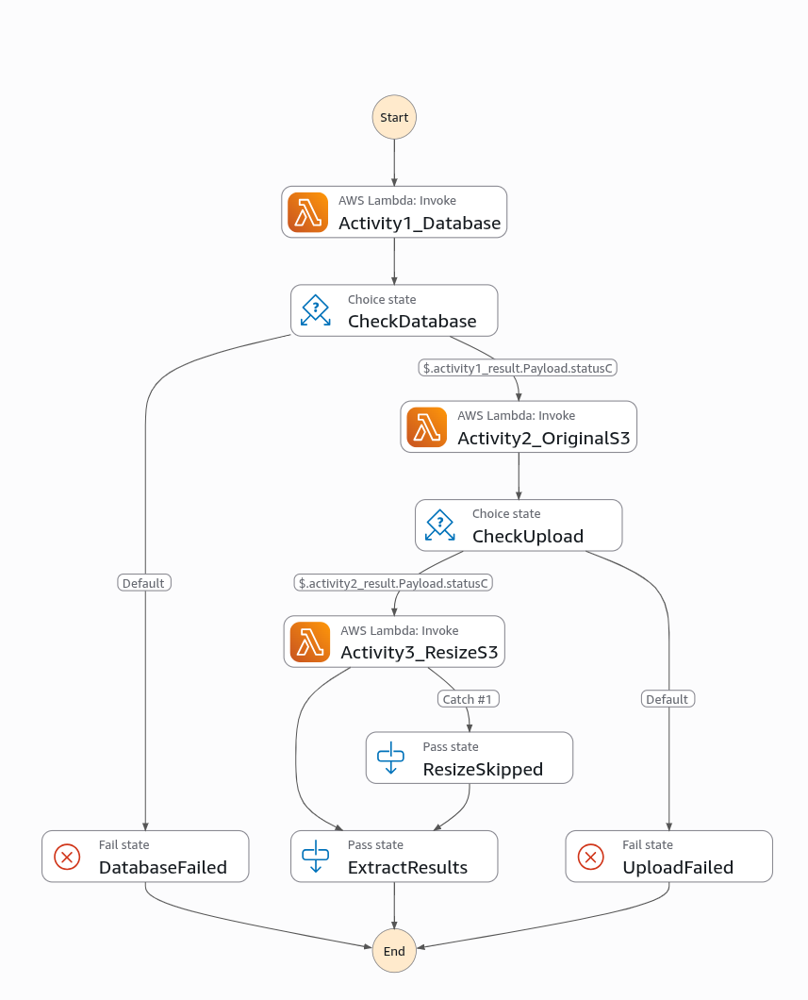

# Serverless Photo Gallery on AWS

A serverless photo gallery on AWS. Users request a login token by email, then upload, list, download, and delete images. Terraform manages the infrastructure. A push to `main` runs GitHub Actions and applies it.

## Architecture

```
Browser (Amplify or S3 website)
       │
       ▼
 API Gateway (REST)
  ├── POST   /auth                 → LambdaGenerateToken
  ├── POST   /orchestrator         → LambdaOrchestrateUploadHandler
  ├── DELETE /delete-orchestrator  → LambdaOrchestrateDeleteHandler
  └── ANY    /  /{proxy+}          → LambdaEntryPoint (router)
                                        ├── ?format=photos    → LambdaGetPhotosDB
                                        ├── ?format=resized   → LambdaGetResizedImage
                                        └── GET/PUT           → LambdaGetObjects
```

`LambdaEntryPoint` checks the query string before the HTTP method. `format=photos` and `format=resized` are handled first. Other GET and PUT requests go to `LambdaGetObjects`.

### Upload flow

`LambdaOrchestrateUploadHandler` checks the token by calling `LambdaTokenChecker`, then starts the Step Functions state machine. The state machine is sequential:



```
Activity1_Database   → LambdaAddPhotoDB     (INSERT into RDS MySQL, must return 200)
Activity2_OriginalS3 → LambdaUploadObjects  (S3 PutObject of the original)
Activity3_ResizeS3   → LambdaResizeWrapper  (sharp, longest edge 100px)
```

A database or original-upload result other than 200 fails the execution. A resize failure is caught and recorded as skipped, so the upload still succeeds. A finished execution with status `FAILED` returns HTTP 500 and does not run again.

If `StartExecution` throws, or `STATE_MACHINE_ARN` is empty, the orchestrator calls the same three Lambdas itself, in the same order.

### Delete flow

`LambdaOrchestrateDeleteHandler` checks the token and that the photo row belongs to that email. It then calls `LambdaDeleteObjects` (original object and the `Photos` row) and `LambdaDeleteResizedObject` (key `resized-<key>`). A missing thumbnail still returns 200.

## AWS services

| Service | Purpose |
|---|---|
| **Lambda** (13 functions) | Business logic, Node.js 20.x, handler `index.handler` |
| **API Gateway** | One REST API |
| **S3** (3 buckets) | Original images, resized images, Terraform state |
| **RDS MySQL 8.0** | Database `Cloud26`, table `Photos(ID, Description, S3Key, Email)` |
| **Step Functions** | Sequential upload workflow |
| **SSM Parameter Store** | HMAC secret `keytokenhash` (SecureString) |
| **SES** | Sends the login token from `from_email` |
| **CloudWatch Logs** | One log group per Lambda, kept 7 days |
| **VPC** | `10.0.0.0/16`, 4 subnets across 2 AZs |
| **IAM** | Shared Lambda role, Step Functions role, Amplify service role |
| **Amplify** | Hosts `index.html` and rebuilds the `main` branch from GitHub |

The `Photos` table is created on the first insert if the new RDS instance does not have it yet.

## Lambda functions

| Function | Role | Memory | Timeout |
|---|---|---|---|
| LambdaEntryPoint | HTTP router | 512 MB | 30s |
| LambdaGenerateToken | Builds the HMAC and emails it | 512 MB | 30s |
| LambdaTokenChecker | The only token verifier | 512 MB | 30s |
| LambdaOrchestrateUploadHandler | Starts the upload workflow | 512 MB | 300s |
| LambdaAddPhotoDB | INSERT into RDS MySQL | 512 MB | 30s |
| LambdaUploadObjects | S3 PutObject (original) | 512 MB | 30s |
| LambdaResizeWrapper | Resize, longest edge 100px | 1024 MB | 60s |
| LambdaGetPhotosDB | SELECT photos from RDS | 512 MB | 30s |
| LambdaGetResizedImage | Serve a thumbnail, resize on demand if missing | 512 MB | 30s |
| LambdaGetObjects | Download an original from S3 | 512 MB | 30s |
| LambdaOrchestrateDeleteHandler | Delete orchestrator and ownership check | 512 MB | 30s |
| LambdaDeleteObjects | S3 DeleteObject and MySQL DELETE | 512 MB | 30s |
| LambdaDeleteResizedObject | Delete the thumbnail | 512 MB | 30s |

`LambdaResizeWrapper` accepts `jpg` and `png`. `LambdaGetResizedImage` also accepts `jpeg` when it resizes on demand.

## Authentication

No Cognito. The token is `HMAC-SHA256(email, secret)`, base64-encoded.

1. The browser `POST`s `{ action: "request_token", email }` to `/auth`.
2. `LambdaGenerateToken` reads the secret from SSM (`SECRET_KEY` is the fallback) and sends the token with SES. The HTTP body is `{ message, email }` and does not contain the token.
3. The user pastes the token from the email. The page stores the email and token in `localStorage` and sends both on later requests.
4. `LambdaTokenChecker` is the only function that recomputes the HMAC. The other functions invoke it and read `body.valid`.
5. Delete checks that the `Photos` row for that key belongs to the email.

SES is in `ap-southeast-2`. `from_email` must be a verified identity. In the SES sandbox the recipient address must be verified too. Production access removes that recipient limit.

`index.html` stores the API base as the placeholder `__API_GATEWAY_BASE__`. Terraform writes the real API URL into the S3 copy. Amplify replaces the same placeholder from the `API_GATEWAY_BASE` environment variable during its build. After apply, CI starts an Amplify release so the hosted page picks up that URL.

## Project structure

```
├── LambdaAddPhotoDB/
├── LambdaDeleteObjects/
├── LambdaDeleteResizedObject/
├── LambdaEntryPoint/
├── LambdaGenerateToken/
├── LambdaGetObjects/
├── LambdaGetPhotosDB/
├── LambdaGetResizedImage/
├── LambdaOrchestrateDeleteHandler/
├── LambdaOrchestrateUploadHandler/
├── LambdaResizeWrapper/
├── LambdaTokenChecker/
├── LambdaUploadObjects/
│   └── index.js, package.json, lambda.zip (CI rebuilds the zip)
├── terraform/
│   ├── bootstrap/          # State bucket and DynamoDB lock table
│   ├── module/rds/
│   ├── 0-variable.tf
│   ├── 1-provider.tf       # S3 remote backend
│   ├── 2-s3.tf
│   ├── 3-iam.tf
│   ├── 4-lambda_entrypoint.tf
│   ├── ...
│   └── 25-ssm_parameter.tf
├── amplify.yml
├── index.html
└── .github/workflows/ci.yml
```

## CI/CD

`.github/workflows/ci.yml` runs on every push and on pull requests.

**`check`** (push and pull request):

- `npm ci`, `node --check`, and a new `lambda.zip` for each function
- `terraform fmt -check`, `terraform init -backend=false`, `terraform validate`

**`apply`** (push to `main` only, after `check`):

- Rebuilds the zips
- `terraform init` against the S3 backend, then `terraform apply -auto-approve`
- Starts an Amplify `RELEASE` job so the frontend is rebuilt with the API URL

A local commit does not run Actions. A push to `main` does. A JavaScript or HTML change still goes through apply: Lambda zips and the S3 copy of `index.html` are Terraform resources.

### GitHub secrets

Secret names are case-sensitive. The workflow reads these repository secrets:

| Secret | Description |
|---|---|
| `AWS_ACCESS_KEY_ID` | IAM access key |
| `AWS_SECRET_ACCESS_KEY` | IAM secret key |
| `TF_VAR_DB_PASSWORD` | RDS master password |
| `TF_VAR_FROM_EMAIL` | Verified SES sender in `ap-southeast-2` |
| `TF_VAR_SECRET_KEY` | HMAC secret |
| `TF_VAR_GITHUB_TOKEN` | GitHub token Amplify uses to read this repo |

## Getting started

### Prerequisites

- Terraform >= 1.9.8
- Node.js 20.x
- AWS credentials that can create the resources above

### 1. Bootstrap remote state (once)

```bash
cd terraform/bootstrap
terraform init
terraform apply
```

This creates the state bucket and the DynamoDB lock table. From `terraform/`, run `terraform init` and migrate any existing local state before relying on CI apply. An empty remote state makes apply create a second stack.

### 2. Build Lambda zips

```bash
for dir in Lambda*/; do
  npm ci --omit=dev --prefix "$dir"
  (cd "$dir" && zip -qr lambda.zip index.js node_modules package.json package-lock.json)
done
```

CI does this on every run. Local apply needs the zips present.

### 3. Variables

```bash
cp terraform/terraform.tfvars.example terraform/terraform.tfvars
```

```hcl
db_password  = "YourSecurePassword123"
secret_key   = "your-hmac-secret-key"
from_email   = "you@example.com"
github_token = "ghp_your_token"
```

`github_repo` defaults to `https://github.com/minhtri1612/AWS_VGU`.

RDS password rules: at least 8 characters, one letter, one digit. Allowed characters are `a-z A-Z 0-9 + _ ? - .`

Changing `secret_key` invalidates tokens that were already issued. `from_email` must already be verified in SES.

### 4. Deploy

```bash
cd terraform
terraform init
terraform plan
terraform apply
```

Pushing `main` runs the same apply in GitHub Actions.

### 5. Destroy

Push to `main` only applies. Destroy is a manual Actions run so a normal push cannot delete the stack.

On GitHub: **Actions → CI → Run workflow → action: destroy → Run workflow**. That job inits, empties the two image buckets, then runs `terraform destroy -auto-approve` with the same secrets as apply. The state bucket and lock table in `terraform/bootstrap` stay. The next push to `main` applies and creates the stack again.

From a machine that already has the remote state:

```bash
cd terraform
terraform destroy
```

## Outputs

| Output | Description |
|---|---|
| `api_gateway_url` | API base URL written into the frontend |
| `static_website_url` | S3 website endpoint |
| `amplify_app_url` | Amplify URL |
| `amplify_app_id` | Used by CI to start a rebuild |
| `orchestrator_function_url` | Function URL for the upload orchestrator |
| `rds_endpoint` | RDS endpoint |
| `step_functions_state_machine_arn` | Upload state machine ARN |

## Limits

- Upload body: 6 MB, checked in the browser and by API Gateway
- Download: 10 MB, checked with HeadObject in `LambdaGetObjects`
- Thumbnail: longest edge 100 px, aspect ratio kept, white background
- Lambda logs: 7 days
- RDS is publicly accessible for this demo
